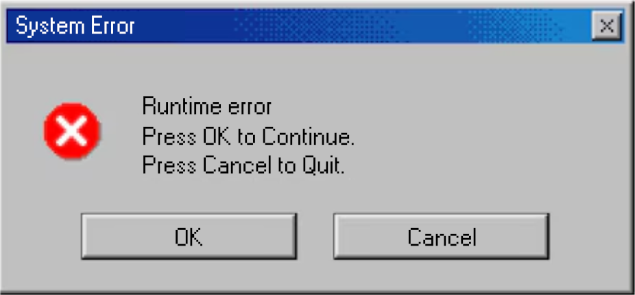

## Heya, Im Benjamin!



``` rust
#[derive(Debug)]
struct Person {
    name: &'static str,
    languages: &'static [&'static str],
    coding: &'static [&'static str],
    tools: &'static [&'static str],
    hobbies: &'static [&'static str],
}

fn main() {
    let me = Person {
        name: "Benjamin",
        languages: &["no", "en"],
        coding: &["Rust", "Python", "C", "TypeScript"],
        tools: &["React", "Docker", "Tauri"],
        hobbies: &["Coding", "Flight simming", "Working out"],
    };

    println!("Hi! I'm {}, a student on the path towards a coding future!", me.name);
    println!("{me:#?}");
}
```
